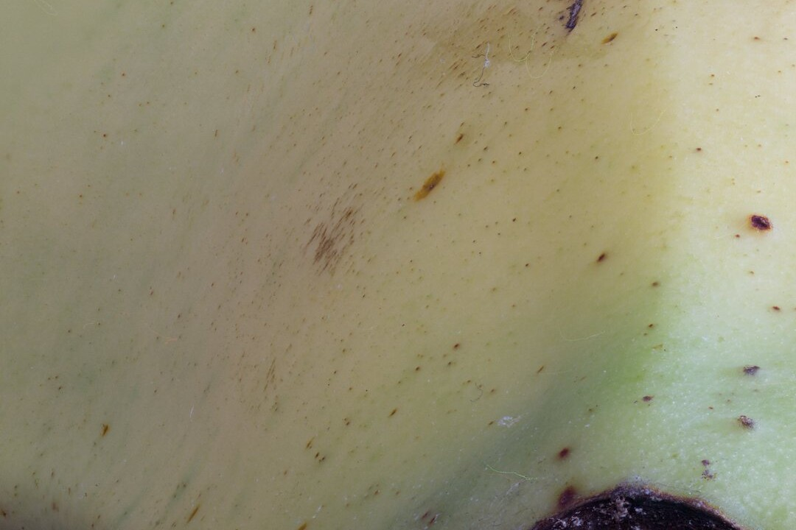
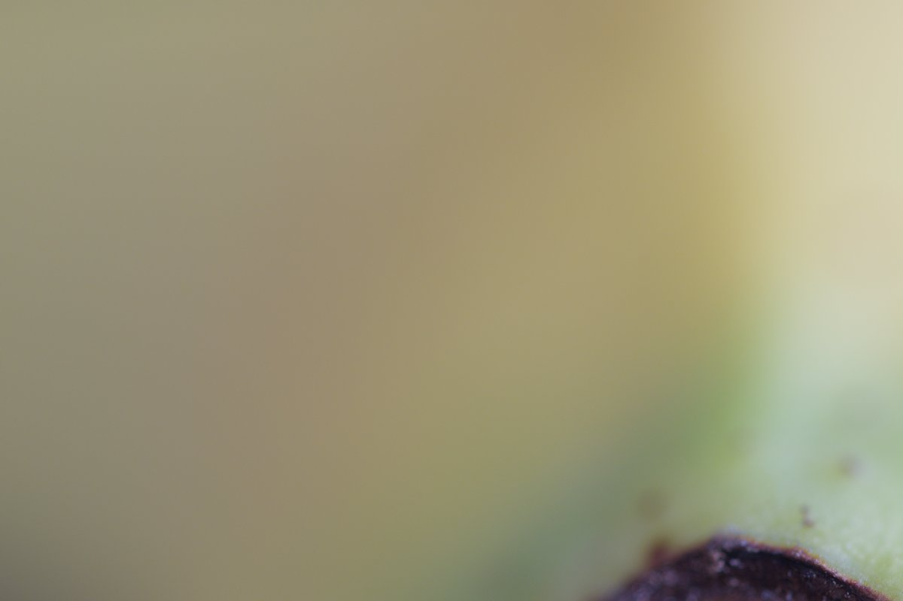
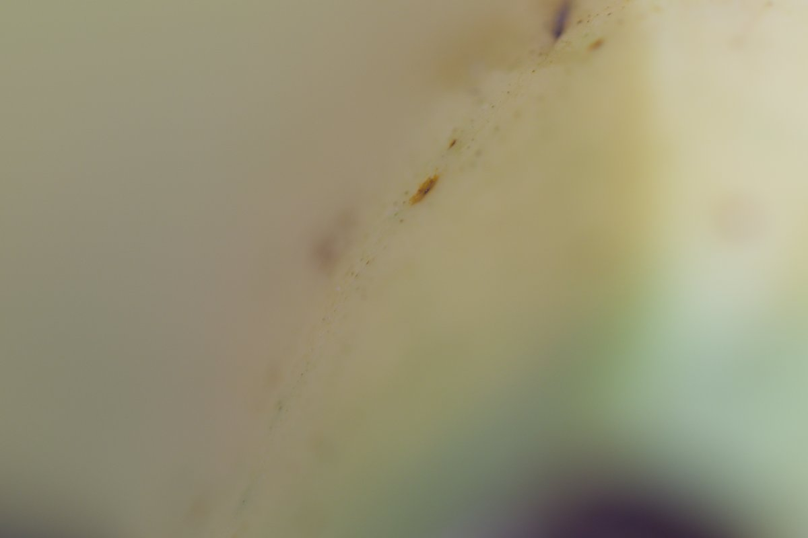
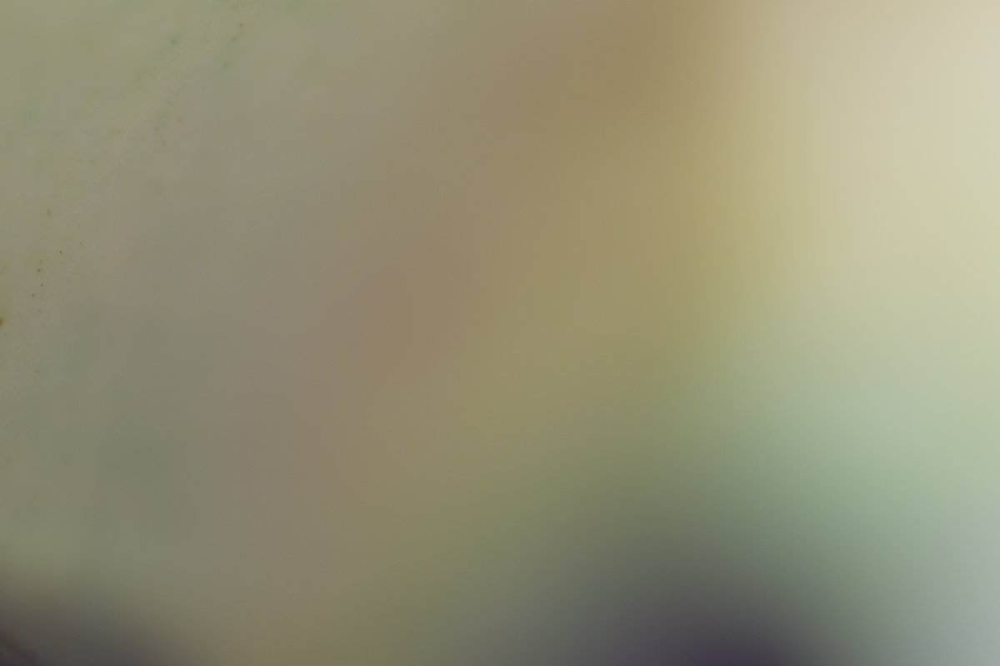

<div align="center">

# Focus Stack Sample

**A real 999-frame macro focus stack for testing focus-stacking software.**

[](https://huggingface.co/datasets/jjjsood/focus-stack-sample)
[](../LICENSE)




</div>

Shot on a Canon EOS R5 Mark II with the RF 100mm F2.8 L Macro, 999 frames
from front to back. Take the first 10 frames for a quick smoke test, or all
999 to find out how your stacker handles memory, alignment drift and long runs.

The image data (~33 GB) is hosted on
[Hugging Face](https://huggingface.co/datasets/jjjsood/focus-stack-sample).
This repository holds the download and conversion scripts, the checksums and
the previews.

## Quick start

```bash
pip install -U huggingface_hub
git clone https://github.com/jjjsood/focus-stack-sample.git
cd focus-stack-sample
./download.sh 10
```

`download.sh` fetches the first *N* frames into `tiff/`, or into `raw/` with
the `raw` argument:

| Command | Frames | Download |
| --- | ---: | ---: |
| `./download.sh 10` | 10 | 251 MB |
| `./download.sh 100` | 100 | 2.5 GB |
| `./download.sh 500` | 500 | 13 GB |
| `./download.sh 999` | 999 | 25 GB |
| `./download.sh 100 raw` | 100 CR3 | 845 MB |

Frames are in shooting order, so every subset is a contiguous slice of the
focus range, not a sparse sample.

Check the download:

```bash
sha256sum -c SHA256SUMS --ignore-missing
```

## What's in the stack

| Folder | Format | Resolution |
| --- | --- | --- |
| `tiff/` | 8-bit sRGB TIFF, deflate | 5118×3412 |
| `raw/` | Canon CR3, camera originals | 5088×3392 (1.6× crop mode) |

The TIFFs work with any stacking tool (Zerene Stacker, Helicon Focus,
Photoshop, OpenCV and others). Use the CR3 files if you need full bit depth or
your own raw development.

| Frame 0 | Frame 499 | Frame 998 |
| :---: | :---: | :---: |
|  |  |  |

## Capture

| | |
| --- | --- |
| Camera | Canon EOS R5 Mark II |
| Lens | Canon RF 100mm F2.8 L Macro IS USM |
| Sensor mode | 1.6× crop (APS-C area), 17 MP, to save space; ~160 mm full-frame equivalent field of view |
| Aperture | f/2.8 |
| Exposure | 0.3 s |
| ISO | 400 |
| Frames | 999, in about 6 minutes |

## Rebuilding the TIFFs

The TIFFs are the CR3 files developed with darktable's default settings.
To reproduce them, or to re-develop them after changing the export flags in
the script, you need [darktable](https://www.darktable.org/) 5.6 or newer:

```bash
./download.sh 999 raw
./convert.sh
```

`convert.sh` skips frames that already exist, so an interrupted run resumes
where it stopped.

## Repository layout

```
.github/README.md   this page
README.md           Hugging Face dataset card
download.sh         fetch the first N frames
convert.sh          CR3 → TIFF with darktable-cli
SHA256SUMS          checksums of every TIFF and CR3
preview/            JPEG previews
LICENSE             CC BY 4.0
```

## License

The images are licensed under [CC BY 4.0](../LICENSE). Credit: Johannes Sood.
