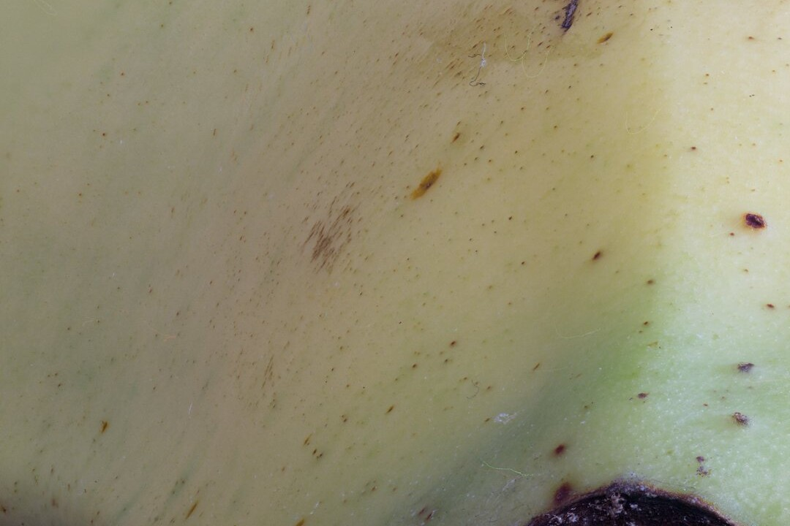
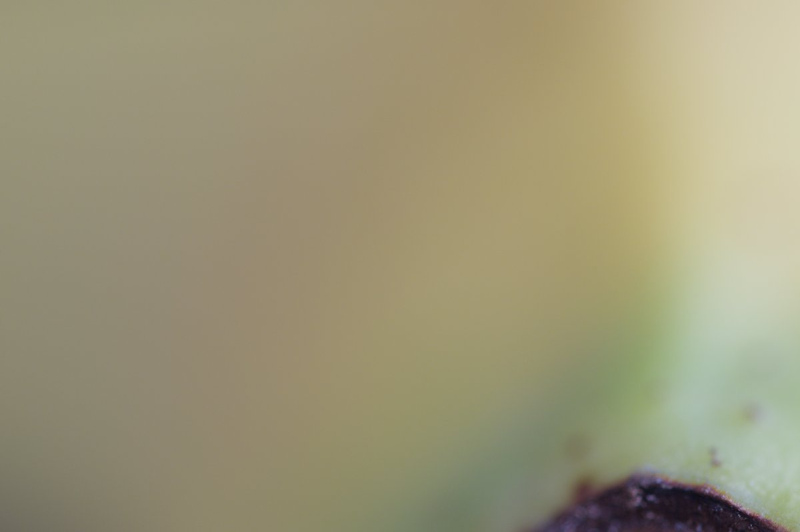
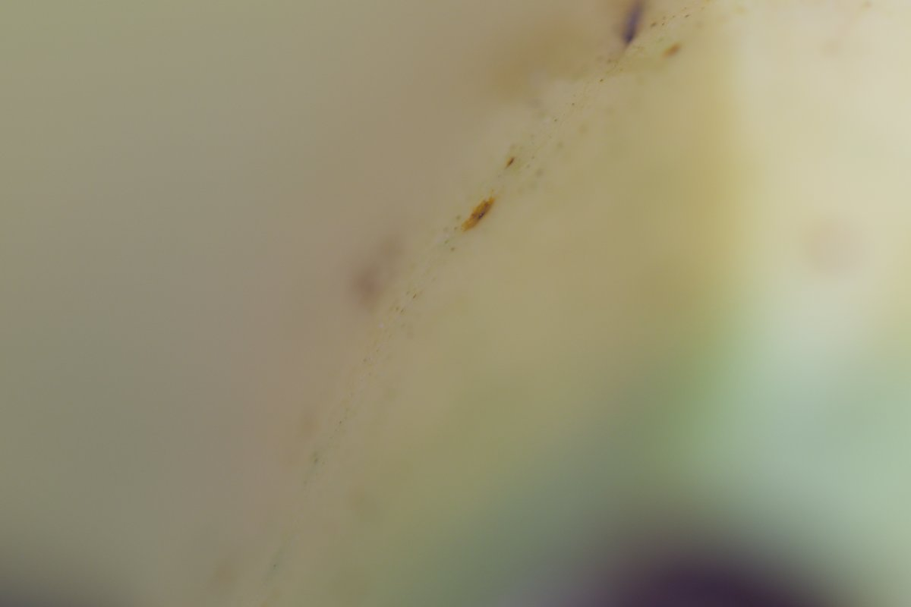
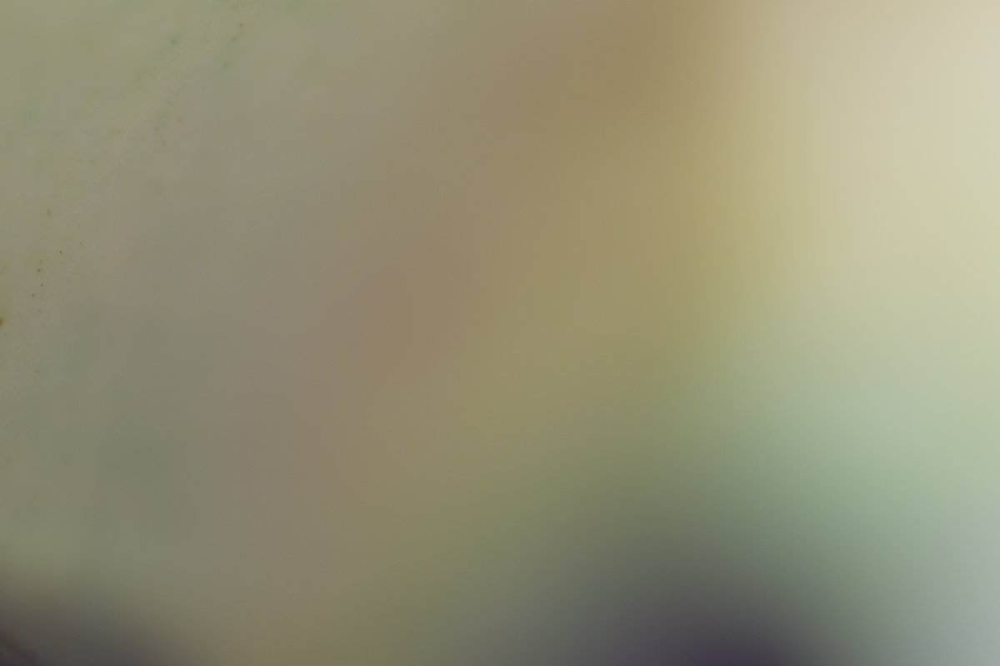

# Focus Stack Sample

A real-world macro focus stack of **999 frames**, shot on a Canon EOS R5 Mark II
with the RF 100mm F2.8 L Macro. It is meant as test data for focus-stacking
software: alignment, fusion, depth-map estimation and performance on long
stacks.



*All 999 frames stacked. Individual frames are shallow slices of this depth
range, as the samples below show.*

| Frame 0 | Frame 499 | Frame 998 |
| :---: | :---: | :---: |
|  |  |  |

## Dataset structure

```
tiff/frame_000.tif … frame_998.tif   8-bit sRGB TIFF, deflate, 5118×3412
raw/frame_000.CR3  … frame_998.CR3   Canon CR3 originals, 5088×3392 (1.6× crop mode)
preview/                             JPEG previews (not part of the stack)
SHA256SUMS                           checksums for tiff/ and raw/
```

Frames are numbered in shooting order, so the first *N* frames are always a
contiguous slice of the focus range. Four subset sizes are served by a single
glob each:

| Frames | TIFF pattern | TIFF size | CR3 size |
| ---: | --- | ---: | ---: |
| 10 | `tiff/frame_00?.tif` | 251 MB | 85 MB |
| 100 | `tiff/frame_0??.tif` | 2.5 GB | 845 MB |
| 500 | `tiff/frame_[0-4]??.tif` | 13 GB | 4.2 GB |
| 999 | `tiff/*` | 25 GB | 8.4 GB |

For CR3, swap `tiff/…tif` for `raw/…CR3`.

## Download

### CLI

```bash
pip install -U huggingface_hub

hf download jjjsood/focus-stack-sample --repo-type dataset --local-dir focus-stack --include "tiff/frame_00?.tif"      # 10
hf download jjjsood/focus-stack-sample --repo-type dataset --local-dir focus-stack --include "tiff/frame_0??.tif"      # 100
hf download jjjsood/focus-stack-sample --repo-type dataset --local-dir focus-stack --include "tiff/frame_[0-4]??.tif"  # 500
hf download jjjsood/focus-stack-sample --repo-type dataset --local-dir focus-stack --include "tiff/*"                  # 999
```

### Python

```python
from huggingface_hub import snapshot_download

path = snapshot_download(
    "jjjsood/focus-stack-sample",
    repo_type="dataset",
    allow_patterns="tiff/frame_0??.tif",  # first 100 frames
)
```

### Verify

```bash
hf download jjjsood/focus-stack-sample SHA256SUMS --repo-type dataset --local-dir focus-stack
cd focus-stack && sha256sum -c SHA256SUMS --ignore-missing
```

## Capture

| | |
| --- | --- |
| Camera | Canon EOS R5 Mark II |
| Lens | Canon RF 100mm F2.8 L Macro IS USM |
| Sensor mode | 1.6× crop (APS-C area), 17 MP, to save space; ~160 mm full-frame equivalent field of view |
| Focal length | 100 mm |
| Aperture | f/2.8 |
| Exposure | 0.3 s |
| ISO | 400 |
| Frames | 999, in about 6 minutes |
| Date | 2026-09-29 |

## Processing

The CR3 files are unmodified camera originals. The TIFFs were developed from
them with darktable 5.6 using its default settings, identical for every frame,
and exported as 8-bit sRGB. No alignment, cropping or retouching was applied.
The script that produced them is in the
[GitHub repository](https://github.com/jjjsood/focus-stack-sample).

Use the CR3 files if you need full bit depth or your own raw development.

## Uses

- Testing and benchmarking focus-stacking tools on a long, real stack.
- Evaluating frame alignment (focus breathing, small shifts between frames).
- Depth-from-focus and depth-map experiments.
- Stress-testing memory use and throughput: 999 × 17 MP frames.

## License and citation

[CC BY 4.0](LICENSE). Please credit Johannes Sood.

```bibtex
@misc{sood2026focusstacksample,
  author       = {Johannes Sood},
  title        = {Focus Stack Sample: a 999-frame macro focus stack},
  year         = {2026},
  howpublished = {\url{https://huggingface.co/datasets/jjjsood/focus-stack-sample}}
}
```
